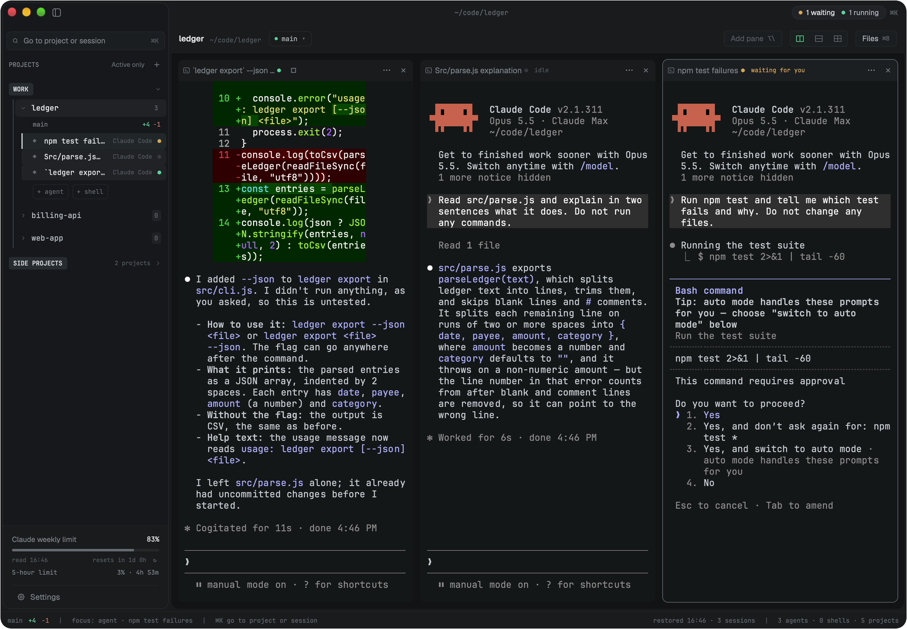
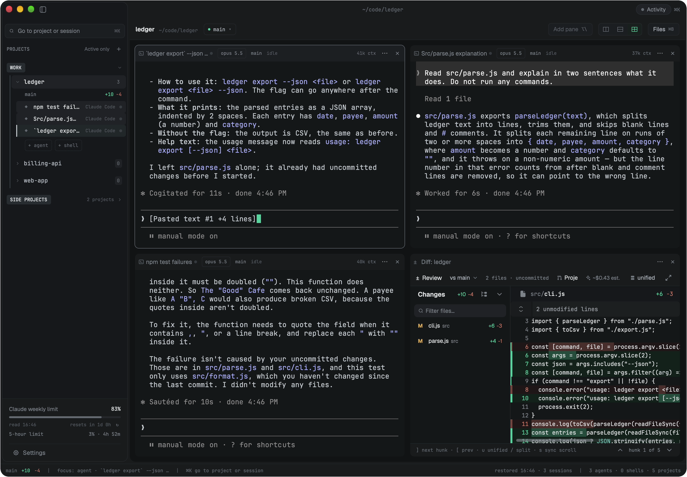
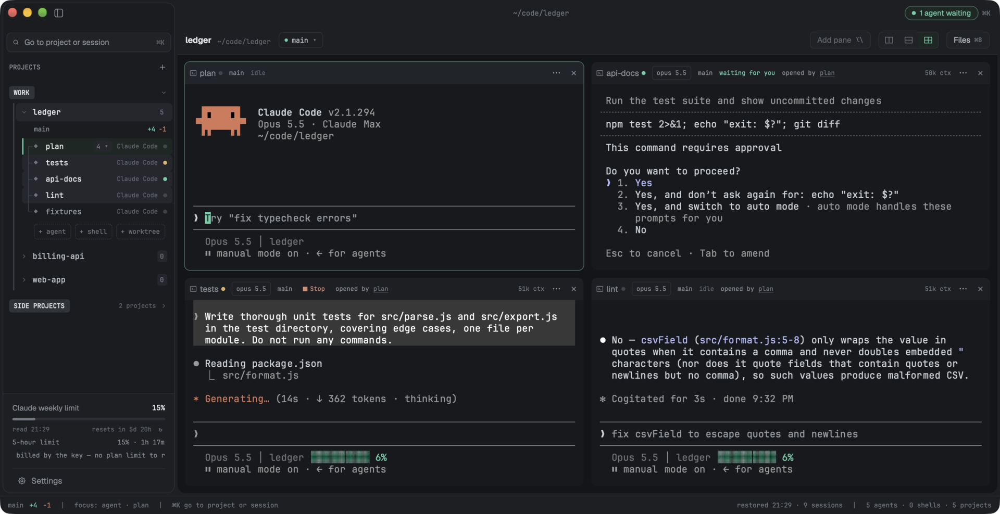

<div align="center">
  
  <h1>Splitlane</h1>
  <p><strong>Run Claude Code, Codex and other coding agents side by side,<br />and see at a glance which one is waiting for you.</strong></p>
  <p>
    <a href="https://github.com/ivkan/splitlane/releases/latest"></a>
  </p>
  <p>
    <a href="#install">Install</a> ·
    <a href="#how-it-knows">How it knows</a> ·
    <a href="#what-is-in-the-window">What is in the window</a> ·
    <a href="#your-phone">Your phone</a> ·
    <a href="#next-to-its-neighbours">Neighbours</a> ·
    <a href="#faq">FAQ</a> ·
    <a href="#docs">Docs</a>
  </p>
</div>

<picture>
  <source media="(prefers-color-scheme: light)" srcset="assets/images/hero-light.png" />
  
</picture>
<p align="center"><sub>Three agents in one project. One is working, one has finished, and one is asking to run <code>npm test</code> - the rail, its pane header and the title bar all say so.</sub></p>

https://github.com/user-attachments/assets/8dbb4e22-822f-4928-90e0-1b394e192eb1

Splitlane is a native desktop app for supervising several CLI coding agents at
once. Every agent runs in a real terminal pane, exactly as it would in your own
terminal. What Splitlane adds is the part a terminal cannot tell you: which
session is working, which has finished, and which is stopped on a question for
you - read from the agents themselves, not guessed from terminal activity.

It is written in Rust on [Zed's GPUI](https://github.com/zed-industries/zed/tree/main/crates/gpui),
runs on macOS, Linux and Windows, and keeps everything local: the agents are
the CLIs you already use, with your own accounts. The one exception is a phone
you pair, which reaches the computer through a relay that forwards end-to-end
encrypted messages it cannot read.

> **Status: early.** Splitlane is used daily on macOS (Apple Silicon). Linux
> (x86_64, aarch64) and Windows (x64) are built and tested in CI but have had
> far less hands-on use. Release builds exist for macOS and Linux; Windows is
> built from source for now - see [Install](#install).

## How it knows

A status dot you cannot trust is worse than none, so each agent's state comes
from the best source that agent offers - and the sources are not equal:

- **Claude Code and Codex** are read directly from their own session records -
  Claude Code's status file and transcript, Codex's rollout - plus the process
  tree under the pane. A permission prompt,
  a running tool call and a finished turn are told apart from what the agent
  recorded, not from whether the terminal is printing.
- **Eight more** - Gemini, Cursor, OpenCode, Pi, Hermes Agent, Grok, CodeBuddy
  and Qoder - report through hooks that a small shim on the pane's `PATH`
  installs for the length of the session.
- **The last six** - Copilot, Kiro, Factory, Antigravity, Openclaw and Amp -
  expose no hook surface Splitlane can use. For them it knows only that the
  process is running and when it exits, so their row can say `running` while
  the agent is in fact waiting for you.

Five words, everywhere a session is listed: `starting`, `running`,
`waiting for you`, `idle`, `failed`. A finished run you have not looked at yet
stays marked until its pane is on screen, so a pile of uncollected results does
not go quiet. You answer an agent in its own terminal; there is no second
approval UI to keep in sync.

## What is in the window

<picture>
  <source media="(prefers-color-scheme: light)" srcset="assets/images/grid-diff-light.png" />
  
</picture>
<p align="center"><sub>The same project as a grid of four: the three agents and the diff of what they changed.</sub></p>

- **Panes.** A project's panes are a row, a column, or a grid of four. `⌥\`
  adds a pane; an empty pane lists the agents on your `PATH`, this project's
  open sessions and its past sessions, and you pick one inside the pane.
- **The rail.** One list of projects, each expanding to its sessions with their
  status. `⌥⇥` jumps to the next session waiting for you.
- **Groups.** Projects can sit under named labels in the rail. Fold a group
  away, or keep its project names out of notifications.
- **Hand an answer over.** A session's last answer goes to another agent on
  screen from the pane's menu, onto its input line; you press Enter. `⌘⌥C`
  copies it instead.
- **A branch per session.** In a git repository each agent session you start
  gets its own worktree and branch, so two agents never edit the same
  checkout, plus ten ports for a dev server. Closing a session whose
  branch holds work asks whether to keep the branch; deleting it saves a
  snapshot for 30 days first. One switch per project turns this off. See
  [Starting work](docs/user/index.md#starting-work).
- **Diff.** A project's changes against its base branch, uncommitted and
  untracked files included, with a file list, a filter and a revision picker,
  in a pane next to the agents that made them.
- **Files.** A tree of the project with git change marks (`⌘B`).
- **History.** Past sessions of every open project, in the palette (`⌘K`,
  then `Tab`), found by anything you wrote in a Claude Code or Codex session,
  not only by its name.
- **Limits.** Your Claude and Codex plan usage in the rail, with when it resets.
- **Sessions outlive the window.** On macOS and Linux the terminals run in a
  separate process, the session host, so closing the window, an update or a
  crash of the window leaves every agent working, and the next start shows
  each one in its pane again. `Running` (`⌥⌘P`) lists every agent and every
  command running in a shell and stops the ones you mark. Where a session does
  end, its conversation resumes on the next launch; a turn that was running
  does not. On Windows the sessions still live in the window's process.
- **Notifications** when a session is waiting, has failed, or (optionally) has
  finished - only for sessions you cannot currently see.
- **Presets.** A saved set of panes, each with its own directory and agent,
  started from the Launch pad (`⇧⌘L`) or with `splitlane up`.
- **For agents.** A read-only MCP bridge (`splitlane mcp install`) lets one
  agent read another pane's output, and a local CLI and JSON-RPC socket
  (`splitlane ls`, `read`, `send`, `wait`, `watch`) script the app. An agent
  in a pane can open sessions of its own and work through them - the next
  section. A script outside a pane can open sessions too and write to the
  ones it opened; into any other pane it types only when you start Splitlane
  with that switched on.

Supported agents: Claude Code, Codex, OpenCode, Gemini, Cursor, Copilot, Amp,
Pi, Hermes Agent, Grok, Kiro, Antigravity, CodeBuddy, Factory, Qoder and
Openclaw. Any other CLI runs in an ordinary shell pane.

Keys above are macOS; Linux and Windows use `Ctrl`-based equivalents that do
not collide with readline. The full list is in Settings → Shortcuts and
[docs/user/keybindings.md](docs/user/keybindings.md).

## One agent working through others

An agent in a pane can open agent sessions of its own: hand each a task, wait
for its turn to end, read the answer, stop it when the plan changes, close it.
Nothing has to be switched on, because it reaches only what it opened - which
is no more than it could do by starting a second agent in its own shell. Done
through Splitlane, each of those sessions is a row in the rail with a status
you can see.

<p align="center">
  
</p>
<p align="center"><sub>One session and the four it opened. One is working, one is waiting for you.</sub></p>

- **You can tell whose a session is.** Sessions sit under the one that opened
  them, joined by a bracket in the margin. The opener's row counts them, and
  the count folds them away; folded, the row says what they are doing. Each
  one's pane says `opened by <name>`.
- **Eight at most, one level deep.** A session that was opened by another
  cannot open any, and it works in its opener's worktree.
- **A session you opened is yours.** When an agent sends to one, nothing is
  written and you are asked, in that agent's own pane: `plan wants to send
  messages to api`. Your answer holds for that pair of sessions until you quit.
  `Stop plan driving` takes it back, and an agent never closes a session you
  opened.
- **An agent closes only what it opened.** Even then, a session in
  the middle of a turn, or waiting for a person, closes only with
  `--stop-turn`. One whose last answer went to you and is still unread
  closes only with `--unread`, which an agent should pass only when you asked
  for the session to be closed.
- **A question meant for you reaches you.** No agent types into a session
  that is waiting for a person, and the notification says which session
  opened the one that is asking.
- **What an agent typed says so.** Text one session sends another starts with
  `[Splitlane] Sent by the agent session "<name>", not typed by a person.`
- **Each step is written down.** `orchestration.jsonl` in the cache directory
  gets one JSON line per open, refusal, prompt handed over, turn started or
  ended, wait for a person, exit and close. A prompt's length is
  recorded, never its text. It is the file to attach when a session was
  opened and never got its task; see
  [Troubleshooting](docs/user/troubleshooting.md#log-files).

Splitlane writes a skill that teaches Claude Code and Codex these commands
each time it starts, so there is nothing to install first: ask an agent in a
pane to open a session in Splitlane. Settings → Agents → Fleet skill turns
that off. The commands and their exit codes are in
[Scripting](docs/user/scripting.md#coordinating-agents-from-a-lead-agent).

## Your phone

A paired phone follows the agent sessions on the computer and answers them.
There is no app to install from a store: it is a page at
<https://splitlane.dev/app> that you add to the home screen. Pairing is
Settings → Phone → **Pair a phone**: scan the QR code from the phone, then
type on the computer the six digits the phone shows, so a photo of the code
is not enough to pair.

- **The list is the rail's.** The same groups and projects, sessions under the
  names the rail gives them, and the ones opened by another session indented
  under it. It opens with **Needs you** - sessions waiting for an answer or
  failed - then **Active**, the projects where something is happening; **All**
  is a tap away.
- **A waiting agent's question, as its screen shows it.** A permission prompt
  comes with its command, and each numbered choice is a button that presses
  its digit. Otherwise you reply in text, press the keys a prompt asks for, or
  interrupt the turn.
- **Last answers in Markdown,** and your plan limits in a line over the list.
- **Starting a session.** **+** picks a project, an agent and a first message,
  and the session starts as one from the launcher would, on its own branch
  where the project gives sessions one, in the rail rather than on the
  computer's screen. At most four phone-started sessions run at once.

Neither side opens a port. Both connect out to `relay.splitlane.dev`, and
every message is encrypted end to end between a key on the computer and one
on the phone; the relay sees only that a message passed, its length and
when. A phone writes only into agent sessions, never into a plain shell, and
**Can reply** in Settings → Phone makes one read-only. Each reply is recorded
on the computer without its text. With the window closed the phone still
reaches the sessions the session host keeps; interrupting and starting a
session need the window. Details in [Your phone](docs/user/phone.md).

## Next to its neighbours

Several tools put coding agents side by side, and three of them come up often
next to this one. Everything said about them here is taken from each project's
own documentation as of October 2026. All three change quickly, so check their
docs before relying on it.

| | Where the agents run | How it learns an agent needs you | Platforms | License |
|---|---|---|---|---|
| Splitlane | Terminal panes in a desktop app, one git worktree per agent session | The agent's own session records for Claude Code and Codex, hooks for eight more; for the rest, only whether the process is alive | macOS, Linux; Windows from source | GPL-3.0-or-later |
| [herdr](https://github.com/herdrdev/herdr) | Panes inside the terminal you already use | Rules matched against what the agent draws on screen; hooks or the agent's own reports for some agents | Linux, macOS, Windows | Apache-2.0 |
| [cmux](https://github.com/manaflow-ai/cmux) | Terminal panes in a native macOS app | Terminal notification sequences, a `cmux notify` command and hooks it installs | macOS | GPL-3.0-or-later |
| [Conductor](https://www.conductor.build) | Its own chat interface, one git worktree per workspace | Its documentation does not say | macOS | Closed source |

The third column is the one Splitlane was built around. A permission prompt and
an idle prompt can look alike on screen, and an agent's interface changes from
one release to the next. Claude Code and Codex each keep a record of their own
session, so Splitlane reads that record and the process tree under the pane,
and leaves the screen out of it. Here's the catch: that works for exactly two
agents, and each has to be checked again when its record format changes. herdr
reports state for more agents than Splitlane does.

Where the neighbours are ahead:

- **herdr** keeps terminals running in a background server after you close it
  or lose an SSH connection, and lists several SSH machines together.
  Splitlane's session host does the first half on macOS and Linux: closing the
  window leaves the agents working. It is local only, though. There is no SSH,
  no second machine, and on Windows closing Splitlane still ends what it
  started.
- **cmux** puts a scriptable browser next to the terminal. Splitlane has no
  browser.
- **Conductor** builds the whole workflow on worktrees, with a setup script and
  a run script for each workspace. Splitlane also gives every agent session a
  worktree and branch of its own, with one setup command and a range of
  ports, and asks before closing a session whose branch holds work. It has no
  run script.

Where Splitlane goes a different way on purpose:

- Agents run in ordinary terminals, the same as outside the app. Conductor
  puts them in its own chat interface and keeps its terminal mode experimental.
- herdr and cmux both give agents an API that can send input to another pane.
  In Splitlane the MCP bridge can only read. An agent types into the sessions
  it opened itself, and into one you opened only after you allow it; typing
  into any other pane stays off until you start Splitlane with it switched on.
- The diff of what the agents changed and the project's file tree are in the
  same window.

If you work inside a terminal or over SSH, herdr or plain tmux will fit better.
If you want agents behind a chat interface rather than in terminals, on a Mac,
that is Conductor. Splitlane is for a few agents in ordinary terminals on your own
machine, where the question is which one is waiting.

## Install

Download the file for your platform from the
[latest release](https://github.com/ivkan/splitlane/releases/latest).

| Platform | File | Notes |
|---|---|---|
| macOS (Apple Silicon) | `splitlane-<version>-aarch64-apple-darwin.dmg` | The image and the app in it are signed and notarized: open the image and drag Splitlane to Applications, or run `brew install --cask ivkan/splitlane/splitlane`. Intel Macs are not built yet. |
| Debian, Ubuntu | `splitlane-<version>-<arch>.deb` | `sudo apt install ./splitlane-<version>-<arch>.deb` |
| Fedora, openSUSE | `splitlane-<version>-<arch>.rpm` | Import the signing key once (check its fingerprint first, see [keys/](keys/README.md)), then install: `sudo rpm --import https://raw.githubusercontent.com/ivkan/splitlane/main/keys/splitlane-release.asc`, then `sudo dnf install ./splitlane-<version>-<arch>.rpm` or `sudo zypper install ./splitlane-<version>-<arch>.rpm`. zypper refuses the package without the key. |
| Other Linux | `.AppImage` or `.tar.gz` | The AppImage runs as is after `chmod +x`. The tarball unpacks to `splitlane.app/`; `splitlane.app/install.sh` installs it under `~/.local` without sudo. |
| Windows | - | No signed installer yet; [build from source](#build-from-source). |

`<arch>` is `x86_64` or `aarch64` (not `amd64`/`arm64`). Linux builds need
glibc 2.35 or newer (Ubuntu 22.04, Debian 12, Fedora 36 and later) and a
Vulkan driver. Every file has a `.sha256` and a minisign
`.minisig` beside it, and the `.deb` and `.rpm` are also GPG-signed;
[keys/README.md](keys/README.md) has the public keys and the commands to check
them. If the AppImage will not start because FUSE is missing, run it with
`--appimage-extract-and-run`.

Splitlane asks the release feed for a newer version at startup and every four
hours after that, for as long as it stays open. When there is one it appears
in the title bar, and a click installs it (through the package manager for a
`.deb` or `.rpm`). A Homebrew install updates the
same way, since the cask only puts the app in place; `brew upgrade --cask
splitlane` works too. `"check_for_updates": false` in `splitlane.json` turns
the check off.

### Build from source

Install Rust with [rustup](https://rustup.rs); the exact toolchain is pinned in
[rust-toolchain.toml](rust-toolchain.toml) and is picked up automatically. Then
the platform's build tools:

- **macOS** (Apple Silicon): Xcode. GPUI compiles its Metal shaders with
  `xcrun metal`, and the Metal compiler ships with Xcode, not with the Command
  Line Tools alone.
- **Linux** (x86_64, aarch64): Vulkan and the Wayland/X11 development
  libraries. On Debian or Ubuntu:

  ```bash
  sudo apt-get install libvulkan-dev libwayland-dev libxkbcommon-dev \
    libxkbcommon-x11-dev libx11-dev libxcb1-dev libxcb-render0-dev \
    libxcb-shape0-dev libxcb-xfixes0-dev libfontconfig1-dev libfreetype6-dev
  ```

- **Windows** (x64): Visual Studio Build Tools with the C++ workload (MSVC).

```bash
git clone https://github.com/ivkan/splitlane.git
cd splitlane
cargo run --release -p splitlane-app
```

The binary is `target/release/splitlane` (`splitlane.exe` on Windows). A
first build takes several minutes: GPUI and its dependencies are compiled from
source.

## FAQ

**Why not tmux with one agent per pane?**
tmux shows you the panes; it cannot tell you which agent is blocked on a
question. If you work over SSH or want something headless, use tmux. Splitlane
is for supervising agents on your own machine, where knowing who is waiting is
the whole job.

**Is it an Electron app?**
No. It is Rust on GPUI, rendering with Metal on macOS, Vulkan on Linux and
DirectX on Windows.

**Does it run agents for me, or in the cloud?**
Neither. The agents are the CLIs installed on your machine, signed in with your
own accounts, running in ordinary terminals. Splitlane never sends a prompt on
its own. An agent can send one to a session it opened itself, and to a session
you opened only after you say it may. A script of yours can open a session
with a task and write to the sessions it opened; into any other pane it
types only when you start Splitlane with that switched on. A paired phone
writes what you type on it, and only into agent sessions.

**Can other agents read my terminals?**
Only agents you register with the MCP bridge, and only to read. Output it hands
to an agent is marked as untrusted content.

**Does it phone home?**
Only if you opt in. Telemetry never includes terminal contents, paths or
prompts, and `SPLITLANE_NO_TELEMETRY=1` turns it off regardless of settings.
Its other connections: it asks GitHub for updates (`"check_for_updates": false`
stops it), reads your Claude plan usage with the login Claude Code already
stored, and, once you pair a phone, keeps a connection to the relay, which
carries only encrypted messages.

## Docs

- [User guide](docs/user/index.md) - installation, layouts, configuration, themes
- [Scripting](docs/user/scripting.md) - the CLI, `splitlane up` and the JSON-RPC socket
- [Your phone](docs/user/phone.md) - pairing, what a phone may do, how it is connected
- [MCP bridge](docs/mcp-bridge.md) - letting agents read other panes
- [Troubleshooting](docs/user/troubleshooting.md) - log files and what to put in an issue
- [Windows notes](docs/WINDOWS.md) - support matrix and caveats
- [Architecture](ARCHITECTURE.md) and [design decisions](docs/internals/design-decisions.md) - for contributors
- [Changelog](CHANGELOG.md) - what changed in each release
- [Contributing](CONTRIBUTING.md) - building, the checks a pull request runs, and how to send one
- [AGENTS.md](AGENTS.md) - instructions for coding agents working on this repository

## Acknowledgements

Splitlane is based on [arthjean/paneflow](https://github.com/arthjean/paneflow)
by Arthur Jean, and is distributed under the same license. It has been modified
since 2026.

The interface is built on [GPUI](https://github.com/zed-industries/zed/tree/main/crates/gpui),
the UI framework of the [Zed](https://zed.dev) editor, by Zed Industries
(Apache-2.0). Some code is adapted from Zed: a few pieces from GPUI
(Apache-2.0) and more from Zed's own crates (GPL-3.0-or-later); see
[THIRD_PARTY_NOTICES.md](THIRD_PARTY_NOTICES.md).

Bundled icons and fonts keep their own licenses; see
[THIRD_PARTY_NOTICES.md](THIRD_PARTY_NOTICES.md). Product names, logos and
brands shown in Splitlane (agent CLIs, editors, programming languages) are
trademarks of their respective owners and are used only to identify those
tools. Splitlane is not affiliated with or endorsed by them.

## License

[GPL-3.0-or-later](LICENSE)
